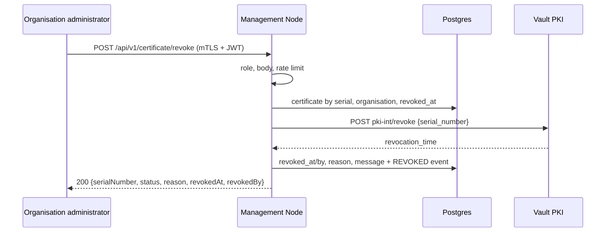

# Certificate Revocation API

**Repository:** `management-node`  
**Description:** `Revocation of an organisation's certificates by its administrator, in Vault PKI and in the Management Node database`  
**SPDX-License-Identifier:** `Apache-2.0 AND OGL-UK-3.0`

---

## Overview

An organisation administrator revokes one of their organisation's certificates when a consumer or producer is compromised or decommissioned. From then on:

- Vault reports the certificate as revoked, and the Management Node [OCSP API](OCSP.md) answers `revoked` with Vault's revocation time and the reason given here. Nodes enforce it within the OCSP response validity, at most 10 minutes.
- The organisation's `organisation_certificate` record says who revoked it, when and why. `CertificateValidationInterceptor` refuses that organisation's calls to `/api/v1/configuration/**`, and the configuration APIs leave the organisation out.
- `POST /api/v1/certificate/csr/sign` refuses to renew it. A new certificate needs a new bootstrap (`POST /api/v1/certificate/bootstrap`), which clears the revocation from the record. The revoked certificate stays revoked in Vault.



---

## Endpoint

| | |
|---|---|
| Method / path | `POST /api/v1/certificate/revoke` |
| Request | `Content-Type: application/json` |
| Authentication | mTLS + JWT bearer token, like every Management Node API |
| Authorization | client role `node_admin` on `management-node`, i.e. `hasAuthority('ROLE_management-node:node_admin')` |
| Organisation | the token's `organisation` claim, matched against `organisation.organisation_key`. Never taken from the request. |

### Request

```json
{
  "serialNumber": "39:dd:2e:90:b7:23:1f:8d:d3:7d:31:c5:1b:da:84:d0:5b:65:31:58",
  "reason": "KEY_COMPROMISE",
  "comment": "Private key exposed on build server"
}
```

| Field | Required | Rules |
|---|---|---|
| `serialNumber` | yes | 1 to 20 hex bytes separated by colons or hyphens, as Vault issues them; case does not matter |
| `reason` | yes | `KEY_COMPROMISE`, `AFFILIATION_CHANGED`, `SUPERSEDED`, `CESSATION_OF_OPERATION`, `UNSPECIFIED` |
| `comment` | no | at most 500 characters; stored with the revocation and written to the audit log |

### Response

`200 OK`:

```json
{
  "serialNumber": "39:dd:2e:90:b7:23:1f:8d:d3:7d:31:c5:1b:da:84:d0:5b:65:31:58",
  "status": "REVOKED",
  "reason": "KEY_COMPROMISE",
  "revokedAt": "2026-10-12T13:15:02Z",
  "revokedBy": "a1b2c3d4-keycloak-user-id"
}
```

`serialNumber` is in Vault's lowercase colon-separated form. `revokedAt` is Vault's `revocation_time`, not the Management Node's clock, so this response and OCSP always agree. `revokedBy` is the token's `sub` claim.

### Errors

Errors use the standard `ErrorResponse` (`status`, `message`, `errorId`).

| Status | When | Changed |
|---|---|---|
| `400` | `serialNumber` missing or not in the format above, `reason` missing or unknown, `comment` too long, or a body that is not JSON. The message names the field. | nothing |
| `401` | token missing, expired or invalid | nothing |
| `403` | caller lacks `node_admin`, the token has no known organisation, or the certificate belongs to another organisation | nothing |
| `404` | no `organisation_certificate` record holds the serial. Vault is not called. | nothing |
| `409` | the certificate is already revoked: the body also carries the original `revokedAt` and `revokedBy` | nothing |
| `409` | the certificate has expired: Vault records no revocation for an expired certificate, which every client rejects anyway | nothing |
| `429` | more than `rate-limit.max-requests` requests in the window; `Retry-After` gives the seconds to wait | nothing |
| `502` | Vault refused the revocation: it does not know the serial, or the Management Node lacks permission | nothing |
| `503` | Vault could not be reached, or answered with a server error, after retries | nothing |
| `500` | Vault revoked the certificate but the database update failed (see [Failure after Vault](#failure-after-vault)) | Vault only |

For a caller without the role, the body is validated before the role is checked, so an invalid body gets `400` rather than `403`. The same applies to every endpoint with a validated body.

---

## Processing

1. Spring Security: mTLS, JWT, then `@PreAuthorize`. The body is validated when it is bound, so in practice before the role check.
2. Rate limit per caller (`sub` claim).
3. Certificate by serial number in `organisation_certificate`, otherwise `404`.
4. The certificate's organisation must be the caller's, otherwise `403`.
5. The record must not be revoked yet, otherwise `409`.
6. Revocation in Vault: `POST <pki-mount>/revoke` with `serial_number`.
7. Database, in one transaction: `revoked_at`, `revoked_by`, `revocation_reason`, `revocation_message`, and a `REVOKED` event in `certificate_events`. The update only applies while the record still holds the serial and is not revoked, so a concurrent request cannot overwrite it; the loser gets `409`.
8. Audit log line and response.

Only certificates held in `organisation_certificate` can be revoked. CA, intermediate and OCSP signer certificates are never held there, so their serials get `404`.

### Vault

Vault is the source of truth: the certificate is revoked there first, and the database follows.

| Vault answer | Result |
|---|---|
| `200` with `revocation_time` | revoked. A certificate that is already revoked in Vault returns its original time, so repeating a request is safe. |
| `200` with `revocation_time` 0 and an "expired" warning | `409`, nothing recorded |
| `400` "not found" | `502` |
| `403`, or a failed login | `502`, never retried: repeated failed AppRole logins lock the role out |
| other `4xx` | `502` |
| `429`, `5xx`, connection failure | retried with exponential backoff (`vault-retry`), then `503` |

The Management Node's Vault identity needs `update` on `<pki-mount>/revoke`.

Revocations show in `<pki-mount>/cert/:serial`, which the OCSP responder reads, immediately. They reach Vault's CRL when it is next rebuilt. With Vault's default `auto_rebuild=false`, that happens on every revocation.

### Failure after Vault

If the database update fails after Vault revoked the certificate, the request fails with `500` and the Management Node logs an `ERROR`:

```
certificate_revocation_reconciliation_required serial=39:dd:... organisationCertificateId=12 organisationId=3 revocationTime=2026-10-12T13:15:02Z revokedBy=a1b2c3d4-... cause="the database update failed": revoked in Vault, not recorded in organisation_certificate; repeat the request to record it
```

The certificate is revoked for OCSP from that moment, while the record still says it is active. Repeating the same request fixes it: the record is not revoked, so the request reaches Vault again, which answers with the original time, and the database is updated.

---

## Audit

Every authenticated attempt writes one `INFO` line to the console, whatever the outcome, including refusals by role and invalid bodies:

```
certificate_revocation_audit caller="a1b2c3d4-..." clientId="FEDERATOR_ENV" organisation="ENV" serial="39:dd:2e:..." reason="KEY_COMPROMISE" comment="Private key exposed on build server" outcome=REVOKED httpStatus=200 timestamp=2026-10-12T13:15:02.418Z
```

| Field | Content |
|---|---|
| `caller`, `clientId`, `organisation` | token's `sub`, client id and `organisation` claim |
| `serial`, `reason`, `comment` | as sent in the body, even when invalid |
| `outcome` | `REVOKED`, `INVALID_REQUEST`, `FORBIDDEN`, `NOT_FOUND`, `CONFLICT`, `RATE_LIMITED`, `VAULT_REJECTED`, `VAULT_UNAVAILABLE`, `FAILED` |
| `httpStatus`, `timestamp` | response status and time of the line |

Values taken from the request are quoted, with quotes, backslashes, control characters and line breaks escaped, and cut to length, so a comment cannot fake a line of its own. A field that is absent is logged as `-`. That also applies to a body without a declared length, or one larger than 64 KiB, which is not buffered.

Requests without a valid token (`401`) are refused before the audit filter, and Spring Security logs them.

Vault's audit log also records each `pki-int/revoke` call with the Management Node's identity.

---

## Configuration

```yaml
application:
  vault:
    pki-mount: pki-int                 # mount whose certificates are revoked
  revocation:
    rate-limit:
      max-requests: 10                 # requests per administrator and window
      window: PT1M
    vault-retry:
      max-attempts: 3                  # attempts in total, the first included
      initial-backoff: PT0.2S          # doubled before each further retry
      max-backoff: PT2S
```

The rate limit is counted in memory by each instance, so with several instances an administrator can send up to that many times the limit.

---

## Roles

`node_admin` is a client role on `management-node`, defined in `docker/keycloak/management-node.json` and `docker/keycloak/tofu/clients.tf`. No client gets it from configuration: assign it by hand.

The token must also carry the organisation's key in its `organisation` claim. The federator clients created by `docker/keycloak/tofu` get it from a hardcoded claim mapper, so for a local test, give the role to such a client's service account:

1. Keycloak admin console → realm `mng-node` → **Clients** → `FEDERATOR_ENV` → **Service accounts roles**.
2. **Assign role** → filter by clients → `management-node` `node_admin`.

That client's tokens then carry `organisation=ENV` and the role, and can revoke certificates of organisation `ENV` only. Request a new token after assigning the role.

---

## Manual test

This uses the session variables, `ca.pem`, a running application and a token as in the [OCSP Local Testing Guide](OCSP_LOCAL_TESTING.md), with the role assigned as above.

1. Define two helpers and give organisation `ENV` a certificate:
   - `pg` runs `psql` inside the Postgres container of `docker/keycloak` (the one published on port 5433), so `psql` need not be installed.
   - `issue_for <organisation key> <common name> [ttl]` has Vault sign a certificate with `default-role` (`ttl` defaults to `2h`) and makes it that organisation's current certificate record. It sets `SERIAL` to the serial in the API's format and `STORED` to the database's. The role accepts any key type, so Vault only signs CSRs with it: `issue/default-role` fails with `role key type "any" not allowed for issuing certificates`.

   ```bash
   pg() { docker exec -i "$(docker ps -qf publish=5433)" psql -U keycloak_db_user -d keycloak_db "$@"; }
   issue_for() {
     local ttl=${3:-2h}
     openssl req -new -newkey rsa:2048 -nodes -keyout $2.key -subj "/CN=$2" -out $2.csr 2>/dev/null &&
       docker exec -i -e VAULT_TOKEN=$VAULT_TOKEN vault vault write -field=certificate \
         pki-int/sign/default-role csr=- ttl=$ttl < $2.csr > $2.pem || return
     rm -f $2.key $2.csr
     HEX=$(openssl x509 -in $2.pem -noout -serial | cut -d= -f2 | tr A-F a-f)
     STORED=$(echo $HEX | sed 's/^0*//')
     SERIAL=$(echo $HEX | sed 's/../&:/g; s/:$//')
     pg -c "INSERT INTO mn.organisation_certificate (organisation_id, serial_number, type, issued_at, expires_at)
       SELECT id, '$STORED', 'MANUAL', now(), now() + interval '$ttl' FROM mn.organisation WHERE organisation_key = '$1'
       ON CONFLICT (organisation_id) DO UPDATE SET serial_number = EXCLUDED.serial_number, type = EXCLUDED.type,
         issued_at = EXCLUDED.issued_at, expires_at = EXCLUDED.expires_at,
         revoked_at = NULL, revoked_by = NULL, revocation_reason = NULL, revocation_message = NULL"
   }
   issue_for ENV revoke-test.local
   ```

   Expected: `INSERT 0 1`. `INSERT 0 0` means that no organisation has that key, so check that the data in `db/samples` was loaded.
   - **Existing record:** the migration that created `organisation_certificate` gave every organisation that existed then, the samples included, an empty `MANUAL` record. `issue_for` replaces it, or a record written by a bootstrap ([Bootstrap Onboarding](BOOTSTRAP_ONBOARDING.md)).
   - **No record:** an organisation without one gets a new record.
   - **Repeat runs:** any revocation on the record is cleared, so the test can be repeated after a revocation.

2. Revoke it:

   ```bash
   revoke() { "$CURL" -sSk --cert client.crt --key client.key -H "Authorization: Bearer $TOKEN" \
     -H "Content-Type: application/json" -d "$1" -D - \
     https://localhost:8090/api/v1/certificate/revoke; echo; }
   revoke "{\"serialNumber\":\"$SERIAL\",\"reason\":\"KEY_COMPROMISE\",\"comment\":\"manual test\"}"
   ```

   Expected:
   - `200` with `revokedAt`;
   - the record's four revocation columns are set (`pg -c "SELECT revoked_at, revoked_by, revocation_reason, revocation_message FROM mn.organisation_certificate WHERE serial_number = '$STORED'"`);
   - a `REVOKED` row in `mn.certificate_events`;
   - a `certificate_revocation_audit ... outcome=REVOKED` line in the application console.

3. Check OCSP:

   ```bash
   openssl ocsp -issuer ca.pem -cert revoke-test.local.pem -nonce -reqout req.der
   ocsp && verify
   ```

   Expected: `Cert Status: revoked`, `Revocation Time` equal to `revokedAt`, and `Revocation Reason: keyCompromise (0x1)`.

4. Refusals. Run them in this order: the Vault row stops Vault, and the last row uses up the minute's rate limit.

   | Request | Expected |
   |---|---|
   | the same request again | `409` with the original `revokedAt` and `revokedBy` |
   | another organisation's certificate: `issue_for BCC other-org.local`, then revoke `$SERIAL` | `403` |
   | `"serialNumber":"00:11:22"`, held by no record | `404` |
   | `"serialNumber":"zz"` or `"reason":"LOST"` | `400` naming the field |
   | a token without the role | `403` |
   | an expired certificate: `issue_for ENV expired.local 1m`, then revoke `$SERIAL` after that minute | `409`, record unchanged |
   | Vault stopped: `issue_for ENV vault-down.local`, `docker stop vault`, then revoke `$SERIAL` | `503`, record unchanged; the same request gets `200` once Vault is started and unsealed again |
   | more than 10 valid requests within a minute, e.g. with `00:11:22` | `429` with `Retry-After`; earlier requests in that minute count too |

   Every one of them writes an audit line with the matching `outcome`.

Locally the Management Node usually logs in to Vault with an administrator token, which bypasses policies, so the `502` for a permission error only shows with the Management Node's own Vault identity.

---

## Limitations

- **Current certificate only.** `organisation_certificate` holds one certificate per organisation. After a renewal the previous certificate is still valid until it expires, but its serial is no longer in the record, so this API answers `404` for it.
- **Reason after re-issue.** A bootstrap clears the revocation from the record. Vault still reports the old certificate as revoked, but OCSP then answers without a reason.
- **Revocations outside this API.** A certificate revoked directly in Vault is revoked for OCSP, but its record is not updated. No reconciliation job does that yet.
- **Rate limit per instance**, see [Configuration](#configuration).
