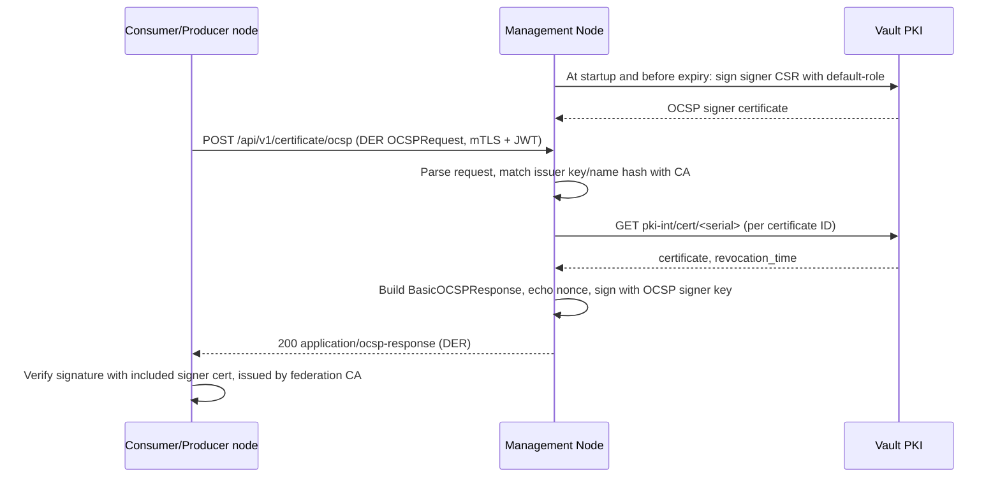

# OCSP Certificate Status API

**Repository:** `management-node`  
**Description:** `OCSP (RFC 6960) certificate revocation status for consumer and producer nodes, backed by Vault PKI`  
**SPDX-License-Identifier:** `Apache-2.0 AND OGL-UK-3.0`  

---

## Overview

Consumer and producer nodes use this endpoint to check whether a peer certificate has been revoked: during mTLS handshakes, and for the life of each gRPC connection. Nodes never call Vault directly. This API is their only source of certificate status.

The endpoint handles a request in four steps:

1. It receives a DER-encoded OCSP request.
2. It looks up each requested certificate in the Vault PKI engine (`GET <pki-mount>/cert/:serial`). Results are not cached, so a revocation in Vault is visible on the very next request.
3. It returns a DER-encoded OCSP response signed by an **OCSP signer certificate**. The Management Node generates the signer key itself and has the federation CA issue the certificate through the default PKI role (`application.vault.default-role`). The certificate is included in every response. It does not carry the `id-kp-OCSPSigning` EKU yet; see [Limitations](#limitations).
4. It echoes the request nonce. Responses are valid for 5 minutes by default (configurable, never more than 10 minutes). This bounds how long a revoked certificate can stay in use.

For a step-by-step manual check against a local Keycloak and Vault, see the [OCSP Local Testing Guide](OCSP_LOCAL_TESTING.md).



---

## Endpoint

| | |
|---|---|
| Method / path | `POST /api/v1/certificate/ocsp` |
| Request | `Content-Type: application/ocsp-request`, body = DER-encoded `OCSPRequest` |
| Response | HTTP `200`, `Content-Type: application/ocsp-response`, body = DER-encoded `OCSPResponse` |
| Authentication | mTLS + JWT bearer token (same as all other Management Node APIs) |
| Authorization | client role `management-node-access`, i.e. `@PreAuthorize("hasAuthority('ROLE_management-node:management-node-access')")` |
| Caching | successful responses: `Cache-Control: max-age=<seconds until nextUpdate>, must-revalidate, no-transform, public`; error responses: `Cache-Control: no-store` |

The `GET /ocsp/{base64}` form is not supported.

### Response semantics

| Situation | OCSP response status | Signed | Certificate status |
|---|---|---|---|
| Certificate issued by the federation CA, not revoked | `successful` | yes | `good` |
| Certificate revoked in Vault | `successful` | yes | `revoked` with Vault's `revocation_time` (see [Limitations](#limitations)) |
| Serial not found in Vault, or issuer name/key hash does not match the federation CA | `successful` | yes | `unknown` |
| Body is empty, larger than `max-request-bytes`, not a valid DER OCSP request, or contains no / too many certificate IDs | `malformedRequest` | no | — |
| Vault cannot be reached (for any certificate ID in the request) | `tryLater` | no | — (never `good`) |
| No valid OCSP signer issued (see [OCSP signer](#ocsp-signer)) | `tryLater` | no | — |
| Unexpected error | `internalError` | no | — |

OCSP error statuses are returned with HTTP `200`, as RFC 6960 requires. Authentication and authorization failures are returned as HTTP `401` / `403` with the standard JSON `ErrorResponse`, before the OCSP layer runs.

### Multiple certificates in one request

A request may contain several certificate IDs. **Every entry is answered** in one signed response, with one `SingleResponse` per certificate ID in request order. The number of entries is limited by `application.ocsp.max-request-entries` (default `10`). Requests with more entries get `malformedRequest`. If Vault fails for any entry, the whole response is `tryLater`.

### Response contents

- `responderID` uses `byKey`, the SHA-1 hash of the signer public key.
- The signer key is EC P-256, so responses are signed with `SHA256withECDSA`.
- `certs` contains the OCSP signer certificate. Nodes verify the response signature with it, and verify that the federation CA issued it. The certificate has no `id-kp-OCSPSigning` EKU, so a client that applies the RFC 6960 delegated-responder check has to trust it explicitly; see [Verifying with OpenSSL](#verifying-with-openssl).
- `producedAt` and `thisUpdate` are the current time (whole seconds). `nextUpdate` is `thisUpdate + application.ocsp.validity`.
- The nonce extension (`id-pkix-ocsp-nonce`) is copied from the request when present.
- Certificate IDs hashed with SHA-1 (OpenSSL default) or SHA-256 are supported.

---

## Keycloak Roles

| Role | Client | Assigned to | Grants |
|------|--------|-------------|--------|
| `management-node-access` | `management-node` | every consumer/producer node service account that checks peer certificates | `POST /api/v1/certificate/ocsp` |

The role is defined in the realm import (`docker/keycloak/management-node.json`) and in OpenTofu (`docker/keycloak/tofu/clients.tf`), and mapped to the federator clients in `docker/keycloak/tofu/terraform.tfvars`. See [Authentication Requirements](AUTHENTICATION_REQUIREMENTS.md).

---

## Code Structure

| Class | Responsibility |
|-------|----------------|
| `controller/v1/OcspController` | HTTP endpoint, role check, `Content-Type` and `Cache-Control` headers |
| `service/providers/certificate/ocsp/OcspResponderService` (`OcspResponderServiceImpl`) | parses the request, matches the issuer, builds and signs the response, logs and metrics |
| `service/providers/certificate/ocsp/CertificateStatusProvider` (`VaultCertificateStatusProvider`) | status lookup per serial number in Vault PKI |
| `service/providers/certificate/ocsp/OcspSignerService` (`OcspSignerServiceImpl`) | generates the signer key, has Vault issue its certificate with the default role, validates it and renews it before it expires |
| `model/dto/certificate/OcspResponseDTO`, `CertificateStatusDTO` | encoded OCSP response with its status and `nextUpdate`; status of a single certificate |
| `utils/http/CacheControlUtil` | `Cache-Control` header derived from the response's `nextUpdate` |
| `config/OcspProperties`, `config/OcspConfig` | `application.ocsp.*` properties (validity limit enforced at startup) and scheduling |

---

## Configuration

```yaml
application:
  vault:
    pki-mount: pki-int                   # PKI mount whose CA the responder answers for
    default-role: default-role           # PKI role that also issues the OCSP signer certificate
  ocsp:
    validity: PT5M                       # nextUpdate - thisUpdate; must be > 0 and <= PT10M (startup fails otherwise)
    max-request-entries: 10              # certificate IDs per request
    max-request-bytes: 16384             # maximum request body size
    status-backend: vault                # CertificateStatusProvider implementation
    signer:
      common-name: ocsp-signer.management-node  # CN of the signer certificate
      ttl: PT24H                         # signer certificate lifetime; at least 4 x refresh-interval
      refresh-interval: PT5M             # how often the signer is checked for renewal
```

The status lookup sits behind the `CertificateStatusProvider` interface. The Vault implementation (`VaultCertificateStatusProvider`) is active when `application.ocsp.status-backend` is `vault`, which is the default.

---

## OCSP signer

The OCSP signer needs no manual setup. The Management Node:

1. generates an EC P-256 key in memory;
2. builds a CSR with the subject `CN=<application.ocsp.signer.common-name>`;
3. has Vault sign it through `<pki-mount>/sign/<application.vault.default-role>` with a TTL of `application.ocsp.signer.ttl`;
4. checks that the certificate carries the generated key, was issued and signed by the CA of `application.vault.pki-mount`, and is currently valid.

This happens when the application is ready. After that, the signer is checked every `refresh-interval` and a new one is issued once the current certificate has passed 70% of its lifetime. If issuing fails, the previous signer is kept while it is still valid. Until the first signer is issued, for example while Vault is unreachable at startup, OCSP requests are answered with `tryLater`.

The signer key is never written anywhere, so each Management Node instance has its own signer, and a restart issues a new one. The default role must accept the signer's common name and EC keys (`key_type=any`), and the Management Node's Vault token already needs `update` on `<pki-mount>/sign/<default-role>` for CSR signing.

---

## Verifying with OpenSSL

`openssl ocsp` cannot present a client certificate or a bearer token itself. Build the request with OpenSSL, send it with `curl`, then let OpenSSL verify the response:

```sh
# 1. Build a request (several -cert/-serial options may be combined) with a nonce
openssl ocsp -issuer ca.pem -cert node.pem -nonce -reqout req.der

# 2. Send it over mTLS with a token that has the management-node-access role
curl -k --cert client.crt --key client.key \
  -H "Authorization: Bearer $TOKEN" \
  -H "Content-Type: application/ocsp-request" \
  --data-binary @req.der -o resp.der \
  https://localhost:8090/api/v1/certificate/ocsp

# 3. Save the signer certificate included in the response and check that the federation CA issued it
openssl ocsp -respin resp.der -resp_text -noverify | sed -n '/BEGIN CERTIFICATE/,/END CERTIFICATE/p' > signer.pem
openssl verify -CAfile ca.pem signer.pem

# 4. Verify the signature with the signer certificate, check the nonce and print the statuses
openssl ocsp -reqin req.der -respin resp.der -issuer ca.pem -VAfile signer.pem -resp_text
```

Expected output includes `signer.pem: OK` in step 3, and `Response verify OK`, one `Cert Status: good|revoked|unknown` per certificate and an `OCSP Nonce` matching the request in step 4.

`-CAfile ca.pem` alone gives `Response Verify Failure` with `missing ocspsigning usage`, because the signer certificate has no `id-kp-OCSPSigning` EKU. `-VAfile` trusts the signer certificate explicitly, which skips that check.

When verifying, pass only `-reqin`. If you also pass `-cert`/`-serial`, OpenSSL builds a new request with a fresh nonce and reports `Nonce Verify error`.

---

## Observability

Every response writes one structured log line per certificate ID. If the request could not be parsed, it writes a single line with `-` placeholders. The `clientId` comes from the MDC:

```
ocsp_response serial=3a99fd78f17d... issuerKeyHash=abd01de546... certStatus=good responseStatus=successful latencyMs=4 requesterIp=10.0.0.12
```

Metrics are exposed through Micrometer at `/actuator/metrics` on the management port:

| Metric | Type | Tags | Meaning |
|---|---|---|---|
| `ocsp.requests` | timer | `response_status` | request rate and latency per OCSP response status |
| `ocsp.cert.status` | counter | `cert_status` (`good`, `revoked`, `unknown`) | certificate statuses returned in successful responses |
| `ocsp.vault.errors` | counter | — | failed Vault status lookups (answered with `tryLater`) |
| `ocsp.signer.expiry.seconds` | gauge | — | seconds until the loaded signer certificate expires (`-1` when none is loaded) |

---

## Load testing

`load-test/ocsp.js` is a [k6](https://k6.io) script that POSTs a prebuilt DER request. It fails when p99 latency exceeds 100 ms or any request fails. See the header of the script for usage. Record results against the agreed SLA and load profile for the target environment.

---

## Security Considerations

- Only callers with the `management-node-access` role can query certificate status. Authentication (mTLS + JWT) and authorization (`@PreAuthorize`) run before any OCSP processing.
- `/api/v1/certificate/**` is **excluded from the CertificateValidationInterceptor**, so the OCSP endpoint does not require the caller to have an `organisation_certificate` record. A node must be able to check a peer's status regardless of the state of its own certificate record.
- The responder **never answers `good` when the status is not known**: a Vault failure for any certificate ID turns the whole response into `tryLater`, and certificates not issued by the federation CA are `unknown`.
- Status results are **never cached** on the Management Node. Clients may cache a successful response until its `nextUpdate`, which is at most 10 minutes away.
- The **signer private key** is generated by the Management Node and lives only in memory. It is never written to disk, to Vault or to the log.
- Error responses (`malformedRequest`, `tryLater`, `internalError`) are unsigned, as RFC 6960 allows, and carry `Cache-Control: no-store`.
- The request body size and the number of certificate IDs per request are bounded (`max-request-bytes`, `max-request-entries`), which limits the Vault calls a single request can trigger.

---

## Limitations

- **Revocation reason:** Vault PKI does not record a reason when a certificate is revoked. `revoked` responses therefore carry Vault's revocation time without the optional `revocationReason`.
- **Transport:** the endpoint is served on the existing HTTPS connector with mTLS and JWT, like the other Management Node APIs. A plain-HTTP listener, which would let nodes check status even when their own certificate is broken, is not implemented yet. Response integrity does not depend on transport, because every successful response is signed.
- **AIA:** do not set this endpoint as `ocsp_servers` in `pki-int/config/urls`. TLS libraries call an AIA OCSP URL automatically and cannot send a JWT, so their requests would be rejected. Depending on the client's configuration, that either fails the handshake or silently skips the revocation check. Vault embeds the URL in every certificate it issues, so it cannot be changed for certificates already issued. Nodes call the endpoint directly with their token. An AIA URL must point at a responder that needs no authentication.
- **Signer certificate:** the signer certificate is issued through the default PKI role, so it has the same key usages as node certificates (`serverAuth`, `clientAuth`) and no `id-kp-OCSPSigning` EKU. Clients that apply the RFC 6960 delegated-responder check (OpenSSL with `-CAfile`, the Java PKIX revocation checker) reject the responses unless they trust the signer certificate explicitly. A dedicated Vault role for the signer is left for later.
