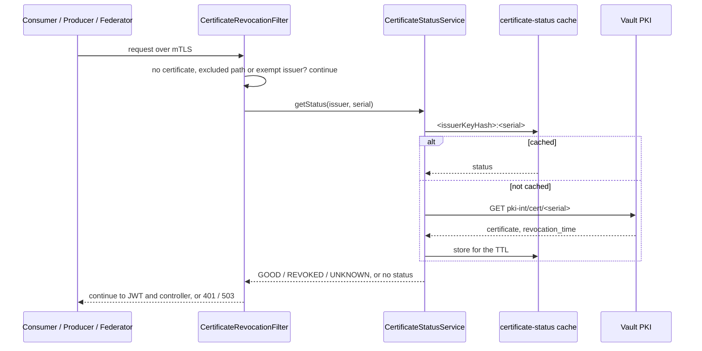

# Certificate Revocation Enforcement

**Repository:** `management-node`  
**Description:** `Refusal of requests whose client certificate is revoked, on every Management Node API, with a certificate status cache and a feature flag`  
**SPDX-License-Identifier:** `Apache-2.0 AND OGL-UK-3.0`

---

## Overview

Every request that presents a client certificate is checked for revocation before it reaches authentication or a controller. A revoked consumer, producer or Federator cannot use any Management Node API.

- The check is a Spring Security filter, `CertificateRevocationFilter`, placed before the bearer token is looked at. A revoked certificate is refused without a token introspection call to Keycloak.
- The status comes from `CertificateStatusService`, which reads Vault (`GET <pki-mount>/cert/:serial`) and caches the answer by issuer and serial. The [OCSP API](OCSP.md) uses the same service and the same cache.
- A revocation through [`POST /api/v1/certificate/revoke`](CERTIFICATE_REVOCATION.md) evicts the cache entry, so it is enforced on the certificate's next request.
- The check is controlled by a feature flag, on by default.



---

## Which requests are checked

| Request | Checked |
|---|---|
| Presents a client certificate, any controller | yes |
| No client certificate: an operator with only a Keycloak token, or mTLS switched off (`server.ssl.enabled=false`) | no; the existing authentication rules apply |
| Path under `excluded-paths` | no, and no status is looked up |
| Certificate issued by an authority listed in `exempt-issuers` | no |
| Actuator on the management port (no TLS, so no certificate) | no |

The client certificate is read from the servlet attribute `jakarta.servlet.request.X509Certificate`, which Tomcat sets when it terminates mTLS. A certificate forwarded in a header by a gateway is not read: if mTLS terminates in front of the Management Node, the filter sees no certificate and checks nothing.

The default excluded paths are `/api/v1/certificate/ocsp`, so a node can ask for its own status when its certificate is broken or revoked, and `/actuator/health`. An excluded path covers the paths beneath it. The OCSP endpoint still requires a token with the `management-node-access` role.

---

## Decisions

| Status | Result |
|---|---|
| `GOOD` | the request continues to authentication and the controller |
| `REVOKED` | `401`, code `CERTIFICATE_REVOKED` |
| `UNKNOWN`: Vault does not know the serial, or the federation CA did not issue the certificate | `401`, code `CERTIFICATE_STATUS_UNKNOWN` |
| No status: Vault is unreachable and nothing is cached | `503`, code `CERTIFICATE_STATUS_UNAVAILABLE` (fail closed) |

The body is the standard `ErrorResponse` with an additional `code`:

```json
{
  "status": 401,
  "message": "Client certificate has been revoked",
  "errorId": "9b8b0bd1-ccdf-40bf-aaba-925da01322ff",
  "code": "CERTIFICATE_REVOKED"
}
```

### Certificates of other authorities

Only the CA of `application.vault.pki-mount` has a status in Vault. A certificate is treated as the federation's when its issuer name is that CA's subject and its signature verifies with that CA's key. Any other certificate is `UNKNOWN` and refused, even though the truststore accepted it in the TLS handshake.

If clients legitimately present certificates of another authority, for example a development root CA or the CA of a website backend, list its distinguished name in `exempt-issuers`. Such certificates are let through without a check, and a `WARN` at startup names the exempt issuers. The federation CA cannot be exempted this way to any effect: an entry only matches certificates with that issuer name.

```bash
openssl x509 -in client.crt -noout -issuer -nameopt RFC2253
```

---

## Caching

| | |
|---|---|
| Cache name | `certificate-status` |
| Key | `<issuerKeyHash>:<serial>`: lowercase hex SHA-1 of the issuer's public key, and the serial in lowercase hex without separators or leading zeros |
| Value | `{status, revokedAt, revocationReason, checkedAt}` |
| Lifetime | `application.revocation.cache.ttl`, 5 minutes by default, at most 10. The application does not start with a longer or non-positive value. |
| Cached | `GOOD`, `REVOKED` and `UNKNOWN` |
| Never cached | a failed lookup: an exception leaves nothing in the cache, so Vault is asked again on the next request |
| Evicted | when the certificate is revoked through the revocation API, right after Vault revoked it and again after the reason is recorded |

The provider is chosen with `spring.cache.type` (`CACHE_TYPE`):

| Provider | Use | Notes |
|---|---|---|
| `caffeine` (default) | one instance | In the memory of the instance. Redis is not configured at all: no connection, no TLS context, no health indicator. |
| `redis` | several instances | Shared, so an eviction on one instance reaches all. Values are JSON, keys start with `dsi:cert-status:`, TLS is on by default (`REDIS_SSL_ENABLED`). |

If Redis cannot be read or written, the status is looked up in Vault as if nothing were cached: requests get slower, not refused. A failed eviction is logged as `ERROR`, since the entry it leaves behind stays in use until it expires.

### Exposure window

| Revocation | Enforced on the Management Node | Visible in OCSP |
|---|---|---|
| Through the revocation API, Redis or a single instance | on the next request | on the next request |
| Through the revocation API, Caffeine with several instances | at once on the instance that took the request; on the others when their entry expires, at most the TTL later | the same |
| Directly in Vault, bypassing the API | when the entry expires, at most the TTL later | the same |

Nodes may cache an OCSP response until its `nextUpdate` (`application.ocsp.validity`). In the last two rows a revoked certificate can therefore stay accepted by nodes for the cache TTL plus the OCSP validity: 10 minutes with both defaults. **Run several instances with Redis, and revoke through the API.** When a certificate has to be revoked directly in Vault, revoke it through the API as well if it has an `organisation_certificate` record, or expect up to the TTL before it is refused.

---

## Feature flag

`application.revocation.enforcement.enabled` (`REVOCATION_ENFORCEMENT_ENABLED`), default `true`. It is read at startup; changing it needs a restart.

When `false`:

- the filter is not registered, so no request is checked and no status is looked up for one;
- a `WARN` is logged at startup: `Certificate revocation enforcement is DISABLED ...`;
- the OCSP API and the revocation API work as before, and the status cache stays in use for OCSP.

A revoked certificate is then accepted by every API except `/api/v1/configuration/**`, where `CertificateValidationInterceptor` still refuses an organisation whose current certificate record is revoked. Disabling the flag outside a test environment is a security decision.

`fail-closed: false` is a weaker switch for an outage of Vault: requests whose status cannot be determined are let through, with a `WARN` per request and one at startup. Revoked and unknown certificates are still refused whenever their status is known.

---

## Configuration

```yaml
spring:
  cache:
    type: ${CACHE_TYPE:caffeine}          # caffeine | redis
    cache-names: certificate-status
  data:
    redis:                                 # only used when CACHE_TYPE=redis
      host: ${REDIS_HOST:localhost}
      port: ${REDIS_PORT:6379}
      password: ${REDIS_PASSWORD:}
      ssl:
        enabled: ${REDIS_SSL_ENABLED:true}
application:
  revocation:
    enforcement:
      enabled: ${REVOCATION_ENFORCEMENT_ENABLED:true}
      fail-closed: true
      excluded-paths:
        - /api/v1/certificate/ocsp
        - /actuator/health
      exempt-issuers: []                   # e.g. - "CN=Dev Root CA,O=Example,C=GB"
    cache:
      ttl: ${REVOCATION_CACHE_TTL:PT5M}    # > 0 and <= PT10M, checked at startup
```

| Property | Default | Meaning |
|---|---|---|
| `application.revocation.enforcement.enabled` | `true` | the feature flag |
| `application.revocation.enforcement.fail-closed` | `true` | answer `503` when the status cannot be determined; `false` lets the request through |
| `application.revocation.enforcement.excluded-paths` | `/api/v1/certificate/ocsp`, `/actuator/health` | path patterns within the application that are never checked |
| `application.revocation.enforcement.exempt-issuers` | empty | issuer distinguished names whose certificates are not checked. From the environment: `APPLICATION_REVOCATION_ENFORCEMENT_EXEMPTISSUERS_0_`, `..._1_`, since a name contains commas. |
| `application.revocation.cache.ttl` | `PT5M` | how long a status is reused; at most `PT10M` |
| `spring.cache.type` | `caffeine` | `caffeine` or `redis` |
| `spring.data.redis.*` | | Redis connection, read only with `spring.cache.type=redis` |

Redis itself, its password in the secret store and its availability are provided by the environment.

Status lookups use `<pki-mount>/cert/:serial` and `<pki-mount>/cert/ca`, which the OCSP API already reads, so the Management Node's Vault policy needs no change.

---

## Observability

Every refusal writes one `WARN` line. Values taken from the request are quoted and escaped:

```
certificate_revocation_enforcement serial=39dd2e90b7 issuer="CN=federation-ca" status=REVOKED path="/api/v1/configuration/producer" clientIp=10.0.0.12 timestamp=2026-11-12T09:30:00Z errorId=9b8b0bd1-...
```

`status` is `REVOKED`, `UNKNOWN` or `UNAVAILABLE`. `errorId` is the one returned to the client.

Metrics at `/actuator/metrics` on the management port:

| Metric | Tags | Meaning |
|---|---|---|
| `revocation.enforcement.rejections` | `status` (`revoked`, `unknown`, `unavailable`) | requests refused by the filter |
| `revocation.status.lookups` | `result` (`good`, `revoked`, `unknown`, `unavailable`) | lookups that reached Vault, that is cache misses, for the filter and OCSP together |
| `cache.gets` | `cache=certificate-status`, `result` (`hit`, `miss`) | cache hit rate |
| `cache.evictions`, `cache.puts` | `cache=certificate-status` | evictions and stored entries |
| `ocsp.vault.errors` | — | failed status lookups against Vault |

A rise of `revocation.enforcement.rejections{status=unavailable}` means Vault is unreachable and requests with certificates not yet cached are being refused.

---

## Code Structure

| Class | Responsibility |
|---|---|
| `web/certificate/CertificateRevocationFilter` | the check on a request, the refusal, the log line and the rejection metric |
| `service/providers/certificate/status/CertificateStatusService` (`CertificateStatusServiceImpl`) | cached status lookup and eviction |
| `service/providers/certificate/status/FederationCaService` (`FederationCaServiceImpl`) | the CA of the PKI mount, and whether it issued a presented certificate |
| `service/providers/certificate/ocsp/CertificateStatusProvider` | the uncached lookup in Vault, behind the status service |
| `config/CertificateStatusCacheConfig` | cache lifetime for Caffeine and Redis, Redis serialisation and key prefix, cache error handling |
| `config/RevocationEnforcementConfig` | the feature flag; `config/SecurityConfig` places the filter in the chain |
| `config/RevocationProperties` | `application.revocation.*`, validated at startup |

---

## Manual test

With the application, Keycloak and an unsealed Vault running as in the [OCSP Local Testing Guide](OCSP_LOCAL_TESTING.md). The usual local `client.crt` is issued by the development root CA, not by Vault, so it is refused as `UNKNOWN` until its issuer is exempt.

| Step | Expected |
|---|---|
| Call any API with the development `client.crt` | `401`, `CERTIFICATE_STATUS_UNKNOWN` |
| Add its issuer to `exempt-issuers` and restart | the request reaches the token check as before |
| Call with a certificate and key issued by `pki-int` | reaches the token check; `cache.gets{result=miss}` rises once, then `hit` |
| Revoke that certificate through `POST /api/v1/certificate/revoke`, then call again | `401`, `CERTIFICATE_REVOKED`, at once |
| Call `/api/v1/certificate/ocsp` with the revoked certificate | not refused by the filter |
| Stop Vault and call with a certificate not seen before | `503`, `CERTIFICATE_STATUS_UNAVAILABLE`; after Vault is back, the same request passes |
| Start with `REVOCATION_ENFORCEMENT_ENABLED=false` | `WARN` at startup; the revoked certificate is not refused by the filter |
| Start with `REVOCATION_CACHE_TTL=11m` | startup fails: `application.revocation.cache.ttl must be greater than 0 and at most PT10M` |
| Start with `CACHE_TYPE=redis` and a local Redis (`REDIS_SSL_ENABLED=false`) | keys `dsi:cert-status:*` appear in `redis-cli`, and the key of a certificate disappears when it is revoked |

---

## Limitations

- **Gateway-terminated mTLS.** A client certificate forwarded in a header is not read. Where mTLS ends at an ingress, this filter checks nothing.
- **Revocations outside the API** are enforced when the cache entry expires; see [Exposure window](#exposure-window). No reconciliation job evicts them earlier.
- **Caffeine with several instances** does not share evictions. Use Redis.
- **The flag is read at startup.** It cannot be toggled at runtime.
